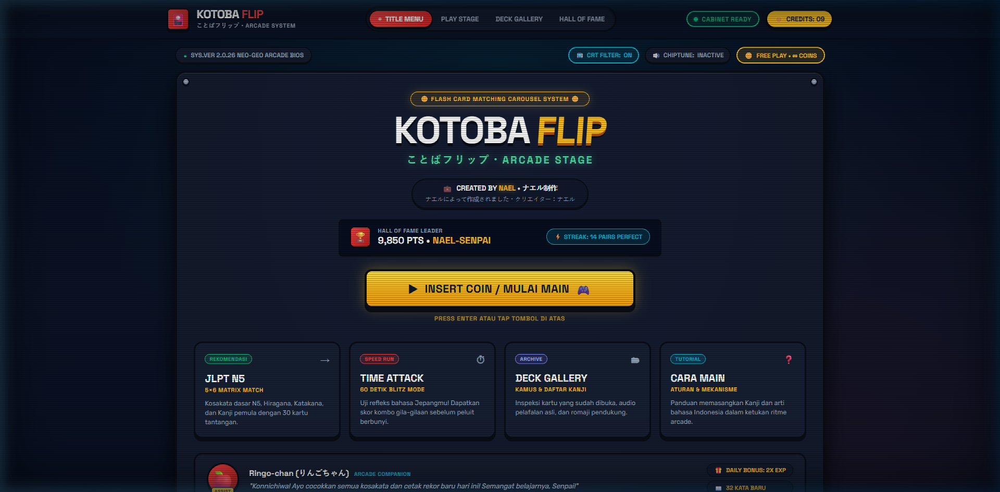

# KOTOBA FLIP (ことばフリップ) - Japanese Flip Card Arcade System

> Mesin arcade memori kosakata bahasa Jepang bertema **Neo-Tokyo Dingdong Retro** dengan estetika Neo-Brutalism & Toy Skeuomorphism.



---

## 🎮 Tentang Game
**KOTOBA FLIP** adalah game memori edukatif interaktif untuk mempelajari kosakata bahasa Jepang (JLPT N5, Katakana, Hiragana, dan Kanji). Dirancang dengan gaya arcade kabinet klasik Neo-Geo tahun 90-an yang dipadukan dengan kontrol responsif modern dan efek suara chiptune retro.

### ✨ Fitur Utama:
* **2 Layar Lengkap dari Google Stitch:**
  1. **Title Menu (Menu Utama):** Marquee logo 3D, seleksi 4 mode, Hall of Fame Leader ribbon, dan dialog maskot Ringo-chan.
  2. **Play Stage (Panggung Utama):** Matriks balok 3D flip card, timer gauge bertingkat, turns, combo multiplier, dan kotoba live log.
* **Mekanisme Pasangan Cerdas:**
  * Kartu A: Karakter Jepang (Katakana/Kanji/Hiragana + Romaji + Suara Native).
  * Kartu B: Arti padanan kata (Bahasa Indonesia / Inggris).
* **Audio Synthesizer Mandiri (Web Audio API):**
  * Suara koin dingdong, putaran kartu, match fanfare, error thud, dan musik BGM chiptune 8-bit tanpa file audio eksternal.
* **Voice Speech Native:**
  * Pengucapan otomatis karakter Jepang dengan Web Speech API (`ja-JP`).
* **Bantuan Maskot Ringo-chan (💡 HINT):**
  * Membuka 2 pasang kartu sekaligus selama 1.5 detik.
* **Tingkat Kesulitan Matrix:**
  * Normal Matrix [4x3] – 12 Balok (6 Pasangan Cepat).
  * Hard Mode Matrix [5x6] – 30 Balok (15 Pasangan Penuh).
  * Time Attack 60 Detik Blitz.
* **Hall of Fame Leaderboard:**
  * Rekor tersimpan di local storage dengan Nael sebagai juara utama.
* **Efek Visual Layar CRT Scanline:**
  * Efek garis monitor tabung retro yang dapat diaktifkan/dinonaktifkan kapan saja.

---

## 🕹️ Kontrol Keyboard & Mouse
* **Klik Mouse / Sentuh:** Membuka kartu, menekan tombol arcade.
* **Enter / Spasi:** Memulai game dari Menu Utama ("INSERT COIN / MULAI MAIN").
* **Tombol Cepat Subbar:**
  * `📺 CRT FILTER`: Hidup / Matikan scanline CRT.
  * `🔊 BGM / CHIPTUNE`: Hidup / Matikan musik arcade chiptune.
  * `🗣️ VOICE`: Hidup / Matikan audio pelafalan Jepang.
  * `🪙 CREDITS`: Tambah koin dingdong.

---

## 🛠️ Teknologi
* **HTML5:** Struktur semantik Web Audio & accessibility.
* **Vanilla CSS3:** Desain Neo-Brutalism, 3D card transforms (`transform-style: preserve-3d`), filter CRT, dan keyframe spring physics.
* **Vanilla JavaScript (ES6+):** State engine, shuffle Fisher-Yates, combo multipliers, Web Audio synthesizer, dan Web Speech API.

---

## 🚀 Menjalankan Secara Lokal
Buka file `index.html` langsung di browser, atau gunakan server HTTP lokal sederhana:
```bash
# Menggunakan Node.js bawaan
node serve.js
```
Akses di browser: `http://localhost:3456`

---

## 🌐 Deploy ke Netlify
Proyek ini siap dideploy secara statis ke Netlify:
1. Hubungkan repository GitHub ini di [Netlify](https://app.netlify.com).
2. Set **Publish directory** ke `.`.
3. Selesai!

---

*Dibuat oleh Nael • 2026 Kotoba Arcade Labs.*
